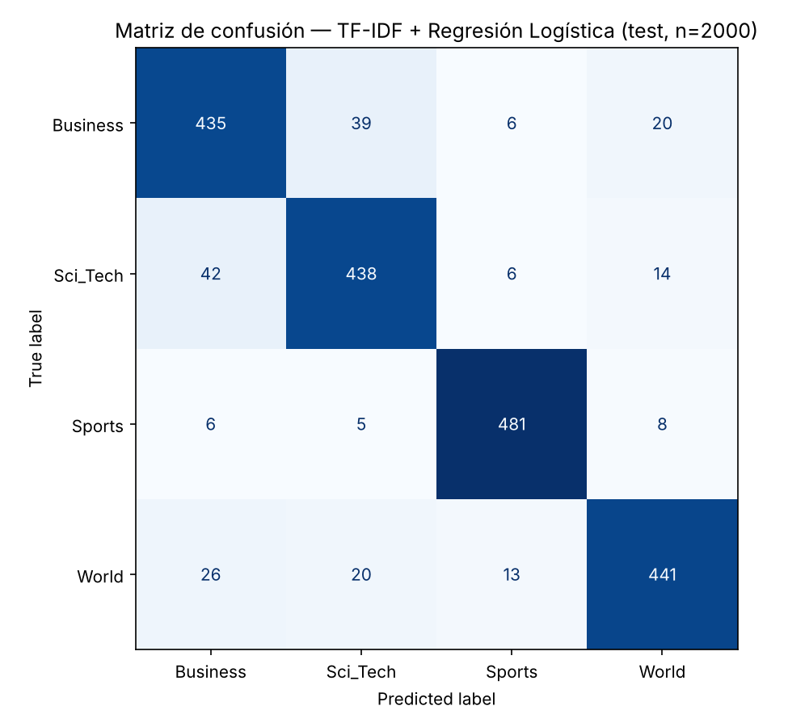

# Clasificador Supervisado con TF-IDF — AG News (Módulo 3)

Pipeline de clasificación de texto clásico (no deep learning): texto crudo →
preprocesamiento (reutilizado del Módulo 2) → vectorización **TF-IDF** →
clasificador de **Regresión Logística** → evaluación.

Mismo corpus que los módulos anteriores: **AG News** (4 categorías: Business,
Sci_Tech, Sports, World — 8.000 docs de train, 2.000 de test, perfectamente
balanceado).

## Setup

```bash
pip install -r requirements.txt
python -m spacy download en_core_web_sm
```

## Estructura

```
.
├── data/
│   ├── ag_news_train.csv         # provisto por la cátedra
│   ├── ag_news_test.csv           # provisto por la cátedra
│   ├── train_preprocesado.csv      # generado por run_preprocessing.py
│   └── test_preprocesado.csv        # generado por run_preprocessing.py
├── src/
│   ├── preprocess.py                 # limpieza + lematización (reusado del Módulo 2)
│   ├── run_preprocessing.py            # aplica preprocess_batch a train y test
│   └── run_tfidf_pipeline.py             # TF-IDF + modelo + evaluación
├── outputs/
│   ├── comparacion_configs_tfidf.csv       # experimentación con max_features/ngram_range
│   ├── classification_report.txt            # precision/recall/f1 por clase
│   ├── matriz_confusion.png                   # matriz de confusión del test
│   └── resumen_resultados.json                 # métricas en formato json
├── requirements.txt
└── README.md
```

## Cómo correrlo

```bash
cd src
python run_preprocessing.py     # limpia y lematiza train y test (~17s)
python run_tfidf_pipeline.py     # vectoriza, entrena, evalúa (~10s)
```

## Prevención de data leakage

El `TfidfVectorizer` se **ajusta (`fit_transform`) únicamente sobre el set de
entrenamiento**. Sobre el test se usa solo `transform`, con el vocabulario y
los pesos IDF ya aprendidos en train — el modelo nunca "ve" el vocabulario del
test antes de ser evaluado (ver `run_tfidf_pipeline.py`, sección 2).

La limpieza y lematización (Módulo 2) sí se aplican a train y test por
separado, pero esto **no** es leakage: son transformaciones fila a fila que no
usan ninguna estadística global del corpus (no miran frecuencias ni
vocabulario compartido). La fuga de información solo puede ocurrir en un paso
que *aprende* parámetros a partir de los datos — y ese paso es exactamente el
`fit` del vectorizador, que se restringe a train.

## Elección del vectorizador: experimentación

Se probaron 4 configuraciones de `TfidfVectorizer` (todas con Regresión
Logística como clasificador), variando `max_features` y `ngram_range`:

| Configuración | Tamaño de vocabulario | F1-macro (test) |
|---|---|---|
| Unigramas, sin límite | 16.869 | 0.8939 |
| Unigramas, `max_features=5000` | 5.000 | 0.8914 |
| Uni+bigramas, `max_features=5000` | 5.000 | 0.8950 |
| **Uni+bigramas, `max_features=10000`** | **10.000** | **0.8975** |

**Configuración elegida: `ngram_range=(1,2)`, `max_features=10000`,
`sublinear_tf=True`.** Sumar bigramas aporta algo más de señal que solo
unigramas (frases como "oil price" o "prime minister" tienen un significado
distintivo que una palabra sola no captura), y acotar a 10.000 features evita
que el vocabulario crezca innecesariamente (de 16.869 a 10.000) sin perder
desempeño — de hecho lo mejora levemente, probablemente por reducir ruido de
términos muy infrecuentes. `sublinear_tf=True` aplica `1 + log(tf)` en vez del
conteo crudo, lo cual ayuda porque los documentos de AG News son cortos
(mediana ~24 tokens tras la limpieza) y una palabra repetida 4 veces en un
texto corto no debería pesar 4 veces más que si aparece una sola vez.

## Justificación del modelo: Regresión Logística

Se eligió **Regresión Logística** (sobre Naive Bayes o SVM) por tres motivos:

1. **Funciona muy bien con matrices TF-IDF dispersas y de alta dimensión** —
   es el baseline estándar de la industria para clasificación de texto
   clásica, y es el mismo que usa la cátedra como referencia para este
   dataset (F1-macro ≈ 0.90).
2. **Da probabilidades calibradas** por clase (a diferencia de un SVM lineal
   estándar, que da un score sin interpretación probabilística directa),
   útil si más adelante se quiere ajustar un umbral de decisión o comparar
   confianza entre clases.
3. **Es rápido de entrenar y de interpretar**: entrena en segundos sobre
   8.000 documentos, y sus coeficientes son directamente interpretables como
   la importancia de cada palabra/bigrama para cada clase — algo que un SVM
   con kernel no lineal no ofrece.

## Resultados

| Métrica | Valor (test, n=2000) |
|---|---|
| Accuracy | 0.8975 |
| F1-macro | 0.8975 |
| F1-weighted | 0.8975 |

| Clase | Precision | Recall | F1 |
|---|---|---|---|
| Business | 0.85 | 0.87 | 0.86 |
| Sci_Tech | 0.87 | 0.88 | 0.87 |
| Sports | 0.95 | 0.96 | 0.96 |
| World | 0.91 | 0.88 | 0.90 |

## Análisis de la matriz de confusión



**Sports es, por lejos, la categoría más fácil de predecir** (481/500
correctas, F1=0.96): tiene vocabulario muy propio y poco ambiguo (nombres de
equipos, "game", "win", "score"), que no se superpone con las otras tres
clases.

**Business y Sci_Tech son las que más se confunden entre sí** (39 noticias de
Business predichas como Sci_Tech, y 42 en sentido inverso — las dos celdas más
altas fuera de la diagonal). Tiene sentido: ambas comparten vocabulario
corporativo genérico (*company, corp, inc, market, million, report*), porque
muchas noticias de tecnología son en el fondo noticias sobre resultados
financieros de empresas tech (ej. "Google Profit Up in 1st Reported
Quarter"). Para separarlas mejor haría falta vocabulario más específico de
producto/tecnología (nombres de dispositivos, lenguajes, hallazgos
científicos) que TF-IDF por sí solo, sin ese contexto semántico más rico, no
siempre alcanza a capturar — es una limitación esperable de un modelo de
bolsa de palabras ponderada, y motiva pasar a representaciones más ricas
(embeddings/Transformers) en el Módulo 4.

**World** tiene el recall más bajo (0.88): 26 noticias de World se confunden
con Business y 20 con Sci_Tech — probablemente noticias de política
internacional con impacto económico (ej. decisiones de bancos centrales,
sanciones comerciales) que comparten vocabulario con Business.

## Próximos pasos (Módulo 4)

Fine-tuning de un Transformer (`distilbert-base-uncased` + LoRA) sobre el
mismo split de train/test, para comparar contra este baseline TF-IDF
(F1-macro 0.8975) en el Proyecto Final.
